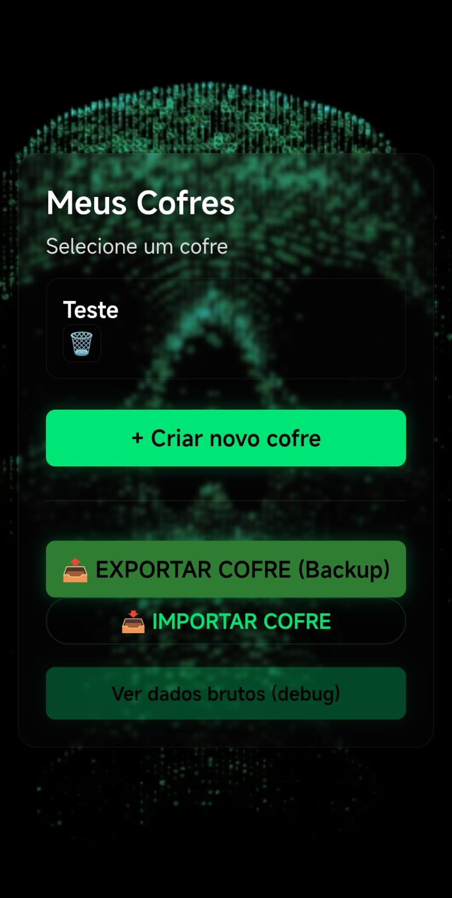
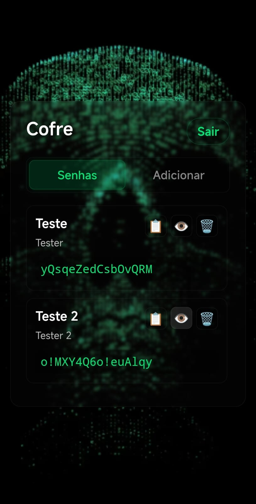
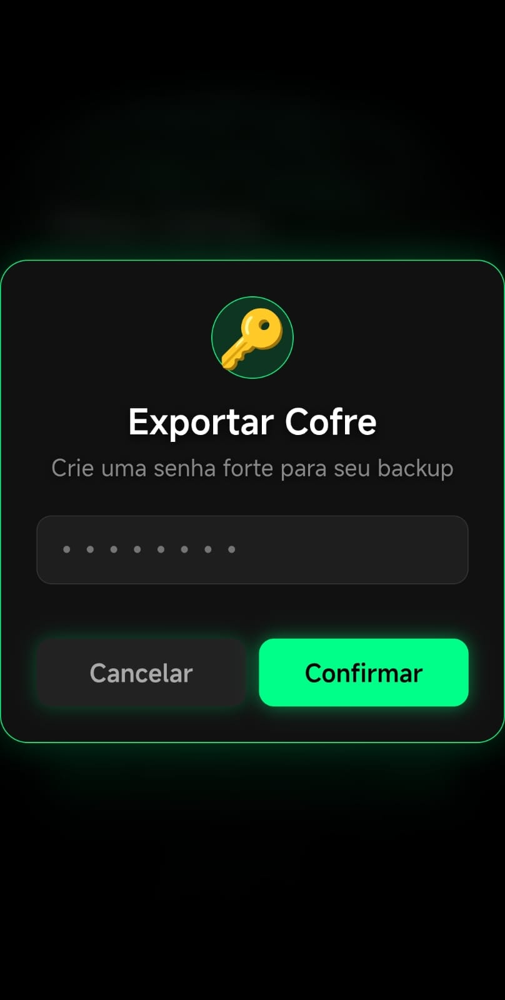

# Security Keys Mobile 🔐

> Cofre de senhas 100% offline-first para Android. Criptografia AES-256-GCM nativa, zero rastreamento, zero nuvem.

**Security Keys Mobile** é um gerenciador de senhas focado em privacidade absoluta. Diferente de LastPass, 1Password ou Bitwarden, ele não tem servidor, não tem nuvem e não tem internet. Todos os seus dados ficam criptografados dentro do seu próprio celular.

[]()
[]()
[]()
[]()

### 📱 Screenshots
| Tela de Cofres | Dentro do Cofre | Export Offline |
|---|---|---|
|  |  |  |

---

## ✨ Funcionalidades

- **Cofres (Vaults) criptografados:** Crie múltiplos cofres com senha mestra
- **Armazenamento local seguro:** Usa Capacitor Filesystem + Preferences
- **Criptografia nativa:** AES-256-GCM + PBKDF2 100.000 iterações (Web Crypto API)
- **Export / Import offline:** Backup de todos os cofres em um único arquivo `.txt` criptografado
- **Zero dependência externa:** Nenhum CDN, nenhum tracker, nenhum servidor

## 🔐 Arquitetura de Segurança

Este projeto não usa `crypto-js` ou libs de terceiros. Toda a criptografia vem de `crypto-mobile.js` com Web Crypto API.

**Senha Mestra** -> PBKDF2 (SHA-256, 100.000 iterações, Salt 16 bytes)
            -> Chave AES-256
            -> AES-GCM (IV 12 bytes aleatório + Auth Tag)
            -> Base64 (salt:iv:ciphertext)


**Garantias:**
1. **Zero Conhecimento:** A senha mestra nunca é armazenada
2. **Resistência a Brute-Force:** 100k iterações
3. **Integridade:** AES-GCM detecta qualquer alteração
4. **Salt e IV únicos:** Cada cofre e backup tem valores diferentes

## 🛠️ Stack

| Camada | Tecnologia |
|---|---|
| **UI** | HTML5, CSS3, JavaScript Vanilla (ES Modules) |
| **Mobile Bridge** | Capacitor 8 |
| **Storage Nativo** | @capacitor/filesystem, @capacitor/preferences, @capacitor/share |
| **Criptografia** | Web Crypto API (nativo do WebView) |
| **Build System** | Gradle + Android Studio |

## 📁 Estrutura do Projeto

armazenador-de-senhas-mobile/
├── www/ / src/                  # Código fonte web
│   ├── index.html               # Entry point (type="module")
│   ├── crypto-mobile.js         # Módulo de criptografia
│   ├── vaults-mobile.js         # CRUD de cofres e entradas
│   ├── backup.js                # Export/import offline
│   └── renderer-mobile.js       # UI e eventos
├── android/                     # Projeto Android nativo
├── capacitor.config.json
├── package.json
└── LICENSE


### Módulos Principais

**`crypto-mobile.js`**
- `hashMaster(password, salt)`, `encrypt(plaintext, password)`, `decrypt(payload, password)`

**`vaults-mobile.js`**
- `createVault(name, masterPassword)`, `getVaults()`, `addEntry()`, `saveVaults()`

**`backup.js`**
- `exportAllVaults(exportPassword)`, `importVaults(file, importPassword)`

---

## 💻 Guia Completo para Desenvolvedores

### 1. Pré-requisitos

Instale no seu PC:

1. **Node.js 18+ LTS** - https://nodejs.org
2. **Java JDK 17 ou 21 LTS** - https://adoptium.net/
3. **Android Studio** - https://developer.android.com/studio
4. **Android SDK API 33+** - Via SDK Manager do Android Studio

**Variáveis de Ambiente (Windows - Obrigatório):**

Teste:
```bash
node -v
java -version
adb --version
npx cap doctor
```

# Instalação

```bash
git clone https://github.com/MiltonRogerio/Armazenador-de-senhas-mobile.git
cd Armazenador-de-senhas-mobile
npm install
npx cap add android
```

# Desenvolvimento

## Sincroniza código web para o Android
```bash
npx cap copy android
```

## Abre no Android Studio
```bash
npx cap open android
```

## Gerar APK

Debug (para testes):

Windows:
```bash
npm run build:apk:win
```

Linux / Mac:
```bash
npm run build:apk
```

## Comandos Úteis

```bash
npx cap doctor        # Diagnóstico do ambiente
npx cap sync android  # Sincroniza plugins
npx cap clean android # Limpa build
adb devices           # Lista dispositivos
adb logcat            # Logs em tempo real
```

# 📦 Sistema de Backup

Exportar: Configurações > Exportar -> arquivo .txt criptografado
Importar: Configurações > Importar -> seleciona arquivo + senha do backup
Funciona 100% offline, inclusive em Modo Avião.

## ❓ Solução de Problemas

gradlew não é reconhecido: No Windows use gradlew, no Linux/Mac use ./gradlew
JAVA_HOME not set: Configure as variáveis de ambiente do passo 1
subtle is undefined: Web Crypto só funciona no WebView do Capacitor. Use npx cap open android

# 👤 Autor e Copyright

Criado e mantido por Milton Rogério De Souza Nogueira Junior

Security Keys Mobile é um projeto open-source criado e mantido por Milton Rogério De Souza Nogueira Junior. Você é livre para usar e modificar, mas a autoria original deve ser sempre preservada.

GitHub: https://github.com/MiltonRogerio
Email: miltonrogerio2267@gmail.com
Repositório: https://github.com/MiltonRogerio/Armazenador-de-senhas-mobile
Copyright (c) 2026 Milton Rogério De Souza Nogueira Junior

## 📄 Licença

Este projeto está sob a licença MIT. Veja o arquivo LICENSE para mais detalhes.
A licença MIT garante que você pode usar, modificar e distribuir este código, desde que mantenha o aviso de copyright original.